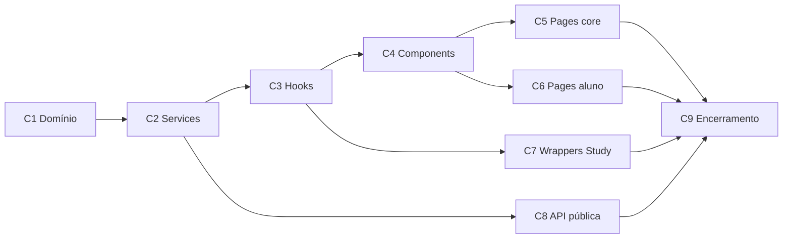

# Roadmap — modularização Coach (C1–C9)

Plano para levar o módulo de **Parcial** (pages + 1 hook) a **Fechado**, espelhando Study S1–S9: fatias pequenas, tag por fase, smoke test, PR isolado.

**Estado atual:** C1–C9 concluídas. Módulo **Fechado**. Tag alvo: `restore/refactor-coach-modular-complete`.

---

## Resumo das fases

| Fase | Escopo | Status |
|------|--------|--------|
| C1 | Domínio + tipos + docs | ✅ |
| C2 | Services (facade Supabase) | ✅ |
| C3 | Hooks (subscription, students, invitations) | ✅ |
| C4 | Componentes UI compartilhados | ✅ |
| C5 | Pages core (landing, dashboard, subscription) | ✅ |
| C6 | Pages aluno (details, invite, accept) | ✅ |
| C7 | Shell coach + wrappers Study | ✅ |
| C8 | API cross-module (`useIsActiveCoach`) | ✅ |
| C9 | index.ts + testes + higiene | ✅ |

Tag final alvo: `restore/refactor-coach-modular-complete`

---

## Mapa de dependências



C7 pode avançar cedo (wrappers já existem) — C9 só após C5–C8.

**Community** desbloqueia COM3 estável após **C8** (check coach em grupos).

---

## Inventário — o que mover

| Arquivo / pasta | Linhas (~) | Fase | Risco |
|-----------------|------------|------|-------|
| `types/coach.ts` | 378 | C1 | Baixo |
| Lógica `calculateStudentPerformance` (Dashboard) | ~80 | C1 | Médio |
| `integrations/supabase/coach/access.ts` | — | C2 | Médio (RPC) |
| `integrations/supabase/coach/relationships.ts` | — | C2 | Médio |
| `integrations/supabase/coach/subscriptions.ts` | — | C2 | **Alto** (callers cross-module) |
| `integrations/supabase/coach/tasks.ts` | — | C2 | Baixo |
| `useCoachStudentGate.ts` | 217 | C3 | Baixo (já no módulo) |
| Queries inline em Dashboard/Details | ~400 | C3 | Médio |
| `CoachInvitationModal.tsx` | 399 | C4 | Médio |
| Widgets inline Dashboard/Details | ~600 | C4 | Médio |
| `CoachDashboard.tsx` | 802 | C5 | **Alto** |
| `CoachSubscriptionPage.tsx` | 547 | C5 | Médio |
| `CoachLandingPage.tsx` | 270 | C5 | Baixo |
| `StudentDetailsPage.tsx` | 875 | C6 | **Alto** |
| `InviteStudentPage.tsx` | 449 | C6 | Médio |
| `AcceptInvitationPage.tsx` | 260 | C6 | Médio |
| Wrappers Study (3 pages) | ~245 | C7 | Baixo |
| Imports em Menu, Planos, Study hooks | — | C8 | **Alto** |
| `CoachGroupsTab` | — | C9 ou Community COM5 | Baixo |

---

## C1 — Domínio + tipos + docs

**Objetivo:** regras puras e tipos dentro do módulo; zero mudança de UX.

### Escopo

1. Criar `modules/coach/domain/`:
   - `studentPerformance.ts` — extrair de `CoachDashboard.calculateStudentPerformance` (usa dados Study read-only)
   - `invitationRules.ts` — estados, expiração
   - `coachPlanLimits.ts` — starter/pro/enterprise → max_students
2. Mover `types/coach.ts` → `modules/coach/domain/types.ts` (re-export deprecated em `src/types/coach.ts`).
3. Criar `docs/coach/MODULE.md` (feito), `RESTORE.md`.

### Fora de escopo

- Mover services ou pages

### Entregáveis

- Tag: `restore/refactor-coach-modular-c1`
- Testes unitários: `studentPerformance`, `invitationRules` (mín. 6 casos)

### Smoke test

- [ ] Dashboard carrega stats iguais (snapshot manual de 1 aluno)
- [ ] Build OK

---

## C2 — Services (facade Supabase)

**Objetivo:** camada `modules/coach/services/` como único ponto de I/O coach; integração Supabase pode permanecer em `integrations/` com re-export tipado.

### Escopo

1. Criar services no módulo que delegam para `integrations/supabase/coach/*`:
   - `coachAccessService.ts`
   - `coachRelationshipService.ts`
   - `coachSubscriptionService.ts`
   - `coachTaskService.ts`
2. Atualizar pages do módulo para importar services locais.
3. Re-exports `@deprecated` nos paths antigos de integração (opcional) ou manter integração como implementação interna.

### Invariantes

- RPCs existentes inalterados
- Nenhuma lógica de negócio nova nos services — delegação + tipagem

### Entregáveis

- Tag: `restore/refactor-coach-modular-c2`
- Testes mock: `checkHasStudentAccess`, `checkIfCanInvite` (2–3 casos)

### Smoke test

- [ ] Convite respeita limite max_students
- [ ] Acesso negado sem RPC allowed

---

## C3 — Hooks

**Objetivo:** extrair React Query das god pages.

### Escopo

1. `useCoachSubscription` — subscription + canInvite
2. `useCoachStudents` — lista + remove + performance agregada
3. `useCoachInvitations` — pending, send, cancel
4. `useCoachStudentDetails` — dados aluno (Details page)
5. Refatorar `useCoachStudentGate` para usar services do módulo

### Entregáveis

- Tag: `restore/refactor-coach-modular-c3`
- Testes de hook com MSW (mín. 4)

### Smoke test

- [ ] Dashboard refetch alunos após remover
- [ ] Gate redireciona token inválido

---

## C4 — Componentes UI

**Objetivo:** fatiar UI reutilizável; pages começam a encolher.

### Escopo

1. `layout/CoachPageShell.tsx` — estados loading/deny/header com nome do aluno
2. `dashboard/StudentCard.tsx`, `TeamStatsStrip.tsx`, `BroadcastMessageDialog.tsx`
3. Mover `CoachInvitationModal` → `components/invitations/`
4. `subscription/PlanComparison.tsx` (extrair de SubscriptionPage)

### Entregáveis

- Tag: `restore/refactor-coach-modular-c4`

### Smoke test

- [ ] Modal convite em notificações funciona
- [ ] Broadcast envia para todos alunos

---

## C5 — Pages core

**Objetivo:** Landing, Dashboard e Subscription como composição de hooks + components.

### Escopo

1. Refatorar `CoachLandingPage`, `CoachDashboard`, `CoachSubscriptionPage` sem mudar rotas.
2. Dashboard: tab alunos vs grupos — grupos continua `CoachGroupsTab` até Community COM5.
3. Remover lógica duplicada de performance (usa domain C1).

### Riscos

- **Alto:** Dashboard — considerar C5a (landing+subscription) e C5b (dashboard)

### Entregáveis

- Tag: `restore/refactor-coach-modular-c5`

### Smoke test

- [ ] `/coach/dashboard` lista alunos e métricas
- [ ] `/coach/subscription` mostra plano ativo
- [ ] Landing CTA leva ao fluxo correto

---

## C6 — Pages aluno e convites

**Objetivo:** Details, Invite, Accept finos; lógica em hooks C3.

### Escopo

1. Refatorar `StudentDetailsPage` com `CoachPageShell` + `useCoachStudentDetails`
2. `InviteStudentPage`, `AcceptInvitationPage` usam `useCoachInvitations`
3. Links para Study (cronograma, disciplinas, criar ciclo) via tokens coach

### Entregáveis

- Tag: `restore/refactor-coach-modular-c6`

### Smoke test

- [ ] Coach abre detalhe aluno via token URL
- [ ] Convite → aceite → aluno aparece no dashboard
- [ ] Links abrem Study em coachMode

---

## C7 — Shell coach + wrappers Study

**Objetivo:** padronizar os 3 wrappers Study com `CoachPageShell`.

### Escopo

1. Unificar loading/deny em `CreateCycleForStudent`, `StudentCycleDisciplinesPage`, `StudentSchedulePage`
2. Garantir props consistentes para `@/modules/study`
3. Documentar contrato coachMode em `MODULE.md`

### Entregáveis

- Tag: `restore/refactor-coach-modular-c7`

### Smoke test

- [ ] Coach edita cronograma do aluno e salva
- [ ] Coach cria ciclo para aluno
- [ ] Coach vê disciplinas do ciclo

---

## C8 — API cross-module

**Objetivo:** callers externos não importam integração Supabase coach.

### Escopo

1. Exportar de `index.ts`:
   - `useIsActiveCoach(userId?)`
   - `coachSubscriptionService` (ou métodos mínimos: `getCoachSubscription`, `isActive`)
   - tipos públicos
2. Migrar imports em:
   - `components/Menu.tsx`
   - `pages/Planos.tsx`
   - `hooks/usePlanLimits.tsx`
   - `modules/study/hooks/useStudyProAccess.ts`
   - `modules/study/hooks/useStudyCyclesV2.tsx`
   - `hooks/useGroupMembers.tsx` (prepara Community)

### Entregáveis

- Tag: `restore/refactor-coach-modular-c8`
- `grep integrations/supabase/coach` fora de `modules/coach` ≈ 0

### Smoke test

- [ ] Menu mostra item Coach só se ativo
- [ ] Study Pro access considera coach
- [ ] Planos destaca plano coach correto

---

## C9 — Encerramento

**Objetivo:** módulo fechado.

### Escopo

1. `modules/coach/index.ts` — API pública final
2. Remover re-exports deprecated (`types/coach.ts` stub se aplicável)
3. `npm run test:coach` (criar script espelhando study/rankings)
4. Atualizar `docs/MATRIZ_MODULARIZACAO.md` — coach → Fechado
5. Tag: `restore/refactor-coach-modular-complete`

### Critério “modular completo”

- [ ] Domain, services, hooks, components, pages, index.ts
- [ ] Nenhum import direto de `integrations/supabase/coach` fora do módulo
- [ ] Wrappers Study finos (< 120 linhas cada)
- [ ] Smoke test coach completo (ver RESTORE.md)

---

## Regras transversais

### Git / restauração

```powershell
.\scripts\refactor\create-restore-point.ps1 -Name "coach-modular-cX" -Message "Coach fase CX"
```

Uma tag por fase. Não misturar coach + community no mesmo PR (exceto C8 + ajuste pontual em useGroupMembers).

### O que nunca fazer

1. Duplicar lógica de cronograma/timer/CRUD Study no coach
2. Bypass de RPC de acesso coach-aluno
3. Expor UUID de aluno em URLs de produção
4. Misturar refactor coach com statistics ou admin

---

## Estimativa

| Fase | PRs sugeridos | Complexidade |
|------|---------------|--------------|
| C1–C2 | 1–2 | Média |
| C3–C4 | 2 | Média |
| C5–C6 | 2–3 | Alta |
| C7–C8 | 1–2 | Média |
| C9 | 1 | Baixa |

**Total:** ~7–9 PRs.

---

## Ordem recomendada

1. **C1** → **C2** → **C3** (fundação)
2. **C7** em paralelo com C4 (wrappers já funcionam — só padronizar shell)
3. **C4** → **C5** → **C6** (UI + god pages)
4. **C8** (desbloqueia Community COM3)
5. **C9**

---

## Próximo passo imediato

**Community COM1** — domínio + tipos (ver [../community/ROADMAP.md](../community/ROADMAP.md)).

---

## Referências

- [MODULE.md](./MODULE.md)
- [RESTORE.md](./RESTORE.md)
- [../study/MODULE.md](../study/MODULE.md)
- [../community/ROADMAP.md](../community/ROADMAP.md)
