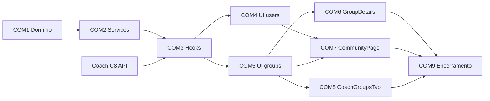

# Roadmap — modularização Community (COM1–COM9)

Plano para levar o módulo de **Shell** (só `CommunityPage`) a **Fechado**, incluindo grupos de estudo e `GroupDetailsPage`.

**Estado atual:** COM1–COM9 concluídas. Módulo **Fechado**.

---

## Resumo das fases

| Fase | Escopo | Status |
|------|--------|--------|
| COM1 | Domínio + tipos | ✅ |
| COM2 | Services (profiles + studyGroups) | ✅ |
| COM3 | Hooks (5 hooks) | ✅ |
| COM4 | Componentes usuários (`community/`) | ✅ |
| COM5 | Componentes grupos (`studyGroups/`) | ✅ |
| COM6 | `GroupDetailsPage` no módulo | ✅ |
| COM7 | Refatorar `CommunityPage` | ✅ |
| COM8 | Integração Coach (`CoachGroupsTab`) | ✅ |
| COM9 | index.ts + testes + higiene | ✅ |

Tag final alvo: `restore/refactor-community-modular-complete`

---

## Mapa de dependências



**Pré-requisito recomendado:** Coach **C8** (`useIsActiveCoach`) antes de COM3 final — ou import temporário `@deprecated`.

---

## Inventário — o que mover

| Arquivo / pasta | Linhas (~) | Fase | Risco |
|-----------------|------------|------|-------|
| `utils/communityProfileRules.ts` | 30 | COM1 | Baixo |
| Sort usuários (inline CommunityPage) | ~40 | COM1 | Baixo |
| `types/studyGroups.ts` | — | COM1 | Baixo |
| `integrations/supabase/community.ts` | 243 | COM2 | Médio |
| `integrations/supabase/studyGroups/*` | 4 arquivos | COM2 | Médio |
| `services/communityUrlObfuscation.ts` | — | COM2 | Baixo |
| `useCommunityUsers.tsx` | 90 | COM3 | Baixo |
| `useStudyGroups.tsx` | 100 | COM3 | Médio |
| `useGroupMembers.tsx` | — | COM3 | Médio (depende coach) |
| `useGroupPosts.tsx` | — | COM3 | Médio |
| `useGroupRequests.tsx` | — | COM3 | Médio |
| `components/community/*` | 7 arquivos | COM4 | Baixo |
| `components/studyGroups/*` | 11 arquivos | COM5 | Médio |
| `pages/GroupDetailsPage.tsx` | ~578 | COM6 | **Alto** |
| `CommunityPage.tsx` | 225 | COM7 | Médio |
| `CoachGroupsTab.tsx` | — | COM8 | Baixo |

---

## COM1 — Domínio + tipos

**Objetivo:** regras puras testáveis; tipos no módulo.

### Escopo

1. `domain/communityProfileRules.ts` — mover de `utils/`
2. `domain/communityUserSort.ts` — extrair sort Coach/Pro/online da page
3. `domain/groupVisibilityRules.ts` — público/privado, caps
4. `domain/types.ts` — mover `types/studyGroups.ts` + tipos de perfil comunidade

### Entregáveis

- Tag: `restore/refactor-community-modular-com1`
- Testes: `communityProfileRules`, `communityUserSort` (mín. 8 casos)

### Smoke test

- [ ] Ordem dos cards inalterada na UI (checklist visual)

---

## COM2 — Services

**Objetivo:** I/O Supabase encapsulado no módulo.

### Escopo

1. `communityProfileService.ts` — RPC `get_public_community_profiles`
2. Facade `studyGroupService.ts` agregando groups/members/posts
3. `communityUrlService.ts` — wrap obfuscation
4. Pages/hooks passam a importar services locais

### Invariantes

- RPC e tabelas Supabase inalterados
- `generateSpecificUsers` (dev seed) isolado ou marcado dev-only

### Entregáveis

- Tag: `restore/refactor-community-modular-com2`

---

## COM3 — Hooks

**Objetivo:** mover os 5 hooks para `modules/community/hooks/`.

### Escopo

1. Mover e renomear (sem `.tsx` se não necessário):
   - `useCommunityUsers`
   - `useStudyGroups`
   - `useGroupMembers`
   - `useGroupPosts`
   - `useGroupRequests`
2. `useGroupMembers`: trocar import coach por `@/modules/coach` (requer Coach C8)
3. Re-exports deprecated em `src/hooks/useCommunityUsers.tsx` etc.

### Entregáveis

- Tag: `restore/refactor-community-modular-com3`
- Testes MSW: fetch profiles, join group (mín. 4)

### Smoke test

- [ ] Busca debounced na comunidade
- [ ] Criar grupo / pedir entrada / aprovar pedido

---

## COM4 — Componentes usuários

**Objetivo:** mover `components/community/` para o módulo.

### Escopo

1. `components/users/UserGrid`, `UserCard`
2. `components/shared/CommunityLoadingState`, `ErrorState`, `EmptyState`, `SectionHeader`
3. `communityCoachCardTheme.ts` → `domain/` ou `components/users/theme.ts`

### Entregáveis

- Tag: `restore/refactor-community-modular-com4`

---

## COM5 — Componentes grupos

**Objetivo:** mover `components/studyGroups/` para `modules/community/components/groups/`.

### Escopo

1. Mover 11 arquivos (GroupsTab, GroupCard, PostCard, modals, etc.)
2. `CreateGroupModal`, `GroupSettingsModal` — validar limites plano
3. Exportar `GroupsTab` na API pública (usado por CommunityPage)

### Entregáveis

- Tag: `restore/refactor-community-modular-com5`

### Smoke test

- [ ] Tab grupos na comunidade
- [ ] Post + comentário no feed

---

## COM6 — GroupDetailsPage

**Objetivo:** page de detalhe dentro do módulo; rota atualizada no App.

### Escopo

1. Mover `pages/GroupDetailsPage.tsx` → `modules/community/pages/GroupDetailsPage.tsx`
2. Fatiar seções (header, feed, membros, settings) usando componentes COM5
3. `App.tsx`: import do módulo
4. Re-export deprecated em `pages/GroupDetailsPage.tsx` (temporário)

### Riscos

- **Alto:** upload capa, permissões admin grupo — fazer COM6a (move) + COM6b (fatiar) se necessário

### Entregáveis

- Tag: `restore/refactor-community-modular-com6`

### Smoke test

- [ ] `/comunidade/grupo/:id` carrega feed
- [ ] Sair do grupo / editar config (owner)
- [ ] Pedidos pendentes (grupo privado)

---

## COM7 — CommunityPage

**Objetivo:** page fina — composição tabs + hooks.

### Escopo

1. Extrair stats strip e search para componentes
2. Remover lógica inline (sort → domain COM1)
3. Imports só de `@/modules/community`

### Entregáveis

- Tag: `restore/refactor-community-modular-com7`

---

## COM8 — Integração Coach

**Objetivo:** Coach consome community sem paths legados.

### Escopo

1. `CoachGroupsTab` importa de `@/modules/community` (`GroupsTab` variant ou hook dedicado)
2. Opcional: `useCoachGroups` wrapper fino em coach que delega para community
3. Documentar fronteira coach ↔ community em ambos MODULE.md

### Entregáveis

- Tag: `restore/refactor-community-modular-com8`

### Smoke test

- [ ] Tab grupos no dashboard coach
- [ ] Coach cria grupo se plano permitir

---

## COM9 — Encerramento

**Objetivo:** módulo fechado.

### Escopo

1. `modules/community/index.ts`
2. Remover `components/community/`, `components/studyGroups/`, hooks legados, stubs pages
3. `npm run test:community`
4. Atualizar `docs/MATRIZ_MODULARIZACAO.md`
5. Tag: `restore/refactor-community-modular-complete`

### Critério “modular completo”

- [ ] `/comunidade` e detalhe grupo só importam do módulo
- [ ] Zero imports de `components/studyGroups` fora do módulo
- [ ] CoachGroupsTab via API community

---

## Regras transversais

### Git

```powershell
.\scripts\refactor\create-restore-point.ps1 -Name "community-modular-comX" -Message "Community fase COMX"
```

### O que nunca fazer

1. Expor UUID de usuário/grupo em URLs prod
2. SELECT amplo em profiles fora do RPC público
3. Duplicar CRUD de grupos no módulo coach
4. Misturar refactor community com statistics

---

## Estimativa

| Fase | PRs | Complexidade |
|------|-----|--------------|
| COM1–COM2 | 1–2 | Baixa–Média |
| COM3 | 1 | Média |
| COM4–COM5 | 2 | Média |
| COM6 | 1–2 | Alta |
| COM7–COM9 | 2 | Baixa–Média |

**Total:** ~7–9 PRs.

---

## Ordem recomendada vs Coach

| Ordem global | Módulo | Fase | Motivo |
|--------------|--------|------|--------|
| 1 | Coach | C1–C7 | Próximo na matriz; wrappers Study já ok |
| 2 | Coach | C8 | API pública coach |
| 3 | Community | COM1–COM2 | Paralelo possível após Coach C2 |
| 4 | Community | COM3–COM7 | Hooks estáveis com `useIsActiveCoach` |
| 5 | Community | COM8–COM9 | Integração coach + fechamento |

Community **COM1–COM2** pode começar em paralelo com Coach **C3–C5** se equipe dividida.

---

## Próximo passo imediato

**Statistics** — definir roadmap S1–S9 (ver matriz de modularização).

---

## Referências

- [MODULE.md](./MODULE.md)
- [RESTORE.md](./RESTORE.md)
- [../coach/ROADMAP.md](../coach/ROADMAP.md)
- [../MATRIZ_MODULARIZACAO.md](../MATRIZ_MODULARIZACAO.md)
