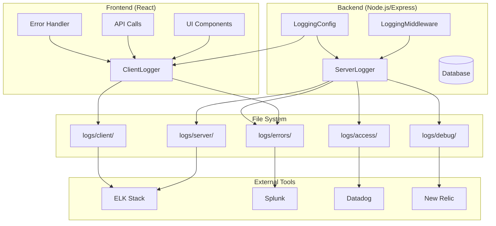
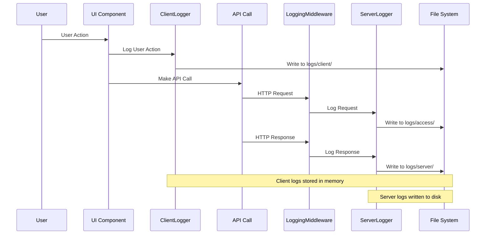
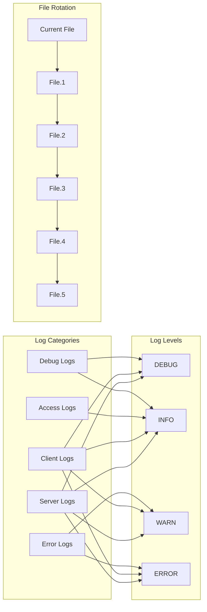
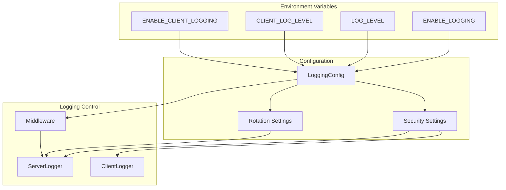
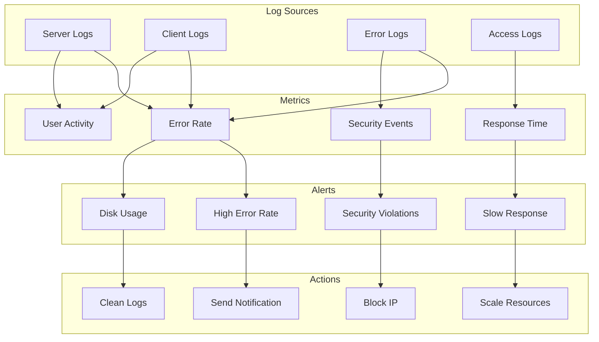
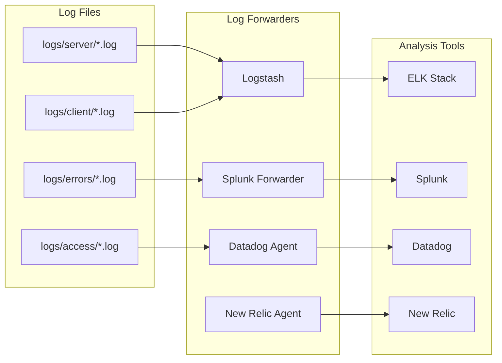
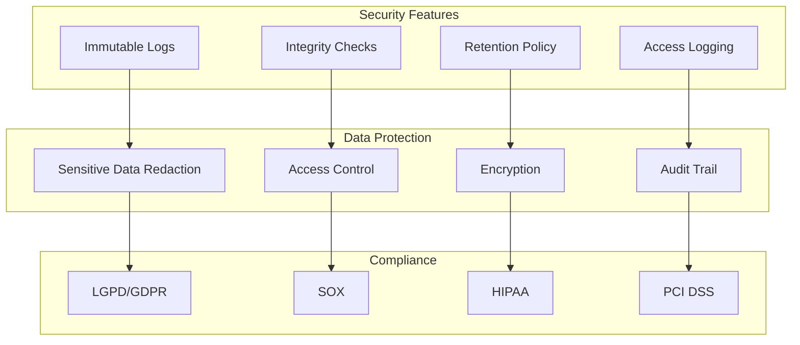

# Arquitetura do Sistema de Logging

## Diagrama de Componentes

## Fluxo de Dados

## Estrutura de Logs

## Configuração e Controle

## Monitoramento e Alertas

## Integração com Ferramentas Externas

## Segurança e Conformidade

