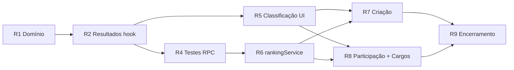

# Roadmap — modularização completa de Rankings

Plano para levar o módulo de **parcialmente modular** (R1–R4 concluídas) a **módulo fechado**, no mesmo espírito do refactor de Estudos: fatias pequenas, tag de restauração por fase, smoke test manual, PR isolado de admin/estudos.

**Estado atual (pós R4):** domínio + listagem + hooks/componentes parciais da classificação dentro de `src/modules/rankings/`. UI grande, serviços e fluxos de criação/participação ainda fora.

**Meta:** qualquer feature de ranking importável via `@/modules/rankings`; `App.tsx` só registra rotas; callers externos usam API pública ou re-exports `@deprecated`.

---

## Arquitetura alvo

```
src/modules/rankings/
  index.ts                    # API pública única
  domain/                     # regras puras (já existe)
  services/
    rankingService.ts         # leitura RPC + ordenação/desempate
    rankingCache.ts
    rankingFormatting.ts      # se ainda necessário
  hooks/
    useResultadosData.ts      # já existe
    useClassificationAccess.ts
    useSaveRanking.ts
    useLeaveRanking.ts
    useRankingParticipationLimits.ts
    …
  components/
    classification/           # tabela, cards, toolbar, acesso negado
    participation/              # AnswerSheet, ParticipationForm, …
    creation/                   # tabs/wizard extraídos de CriarRanking
  pages/
    RankingsPage.tsx            # /pre-classificacao
    ResultadosPage.tsx          # classificação
    CargosPage.tsx              # hierarquia card geral
    ConcursoParticipationPage.tsx
    CriarRankingPage.tsx
```

**Fora do módulo (permanece compartilhado):**

| Peça | Motivo |
|------|--------|
| `integrations/supabase/rankings/` | camada de infra Supabase (como em outros módulos) |
| `SecureConcursoRoute`, `UrlObfuscationService` | segurança transversal |
| Perfil (`UserProfile`, `RankingsTab`) | consome API do módulo, não duplica lógica |
| Admin console | escopo separado; só reutiliza componentes de criação se fizer sentido |

---

## Mapa de dependências entre fases



R1–R4: **feitas**. Próximas: R5 → R6 → (R7 e R8 em paralelo possível) → R9.

---

## Inventário do que falta mover

| Arquivo / pasta | Linhas (~) | Fase sugerida | Risco |
|-----------------|-----------|---------------|-------|
| `pages/ResultadosPage.tsx` | 250 | R5 | Baixo |
| `components/resultados/RankingTable*.tsx`, cards, loading | ~2k | R5 | Médio (perfil, virtual scroll) |
| `services/rankingService.ts` | 900 | R6 | **Alto** (RPC, cache, desempate) |
| `services/rankingCache.ts` | — | R6 | Médio |
| `pages/CriarRanking.tsx` | 730 | R7 | **Alto** (wizard, admin, planos) |
| `hooks/useSaveRanking.ts` | — | R7 | Médio |
| `components/Admin/CreateRanking/*` | — | R7 | Médio |
| `pages/ConcursoParticipation.tsx` | — | R8 | **Alto** (gabarito usuário, RPC save) |
| `components/resultados/AnswerSheet/**` | — | R8 | Alto |
| `hooks/useSaveAnswers/**` | — | R8 | Alto |
| `pages/CargosPage.tsx` | 440 | R8 | Médio |
| `pages/PreClassificacao.tsx` | — | R9 | Baixo (deprecated, remover se morto) |
| Re-exports `utils/rankingNavigation.ts` | — | R9 | Baixo |

---

## Fase R5 — Classificação UI (fechar Resultados)

**Objetivo:** página de classificação e componentes visuais dentro do módulo; `ResultadosPage` deixa de viver em `pages/`.

### Escopo

1. Mover `ResultadosPage.tsx` → `modules/rankings/pages/ResultadosPage.tsx`.
2. Mover para `modules/rankings/components/classification/`:
   - `RankingTable`, `RankingTableVirtual` (se ainda usado)
   - `RankingCard`, `ConcursoInfoCard`, `LoadingState`
   - `ClassificationAccessDenied`, `ResultadosToolbar` (já no módulo — reorganizar pasta)
3. Atualizar `App.tsx`: `lazy(() => import('@/modules/rankings/pages/ResultadosPage'))`.
4. Re-exports deprecated:
   - `pages/ResultadosPage.tsx` → `export { default } from '@/modules/rankings/pages/ResultadosPage'`
5. Garantir que imports internos usem `@/modules/rankings` ou paths relativos do módulo.

### Fora de escopo R5

- `AnswerSheet`, `ParticipationForm` (R8)
- Alterar lógica de `RankingTable` / colunas / desempate

### Entregáveis

- Tag: `restore/refactor-rankings-phase-r5`
- `MODULE.md` atualizado
- Build + `npm run test:rankings`

### Smoke test

- [ ] `/concurso/ranking/:token` carrega tabela
- [ ] Free bloqueado → `ClassificationAccessDenied`
- [ ] Vitrine visível
- [ ] Atualizar classificação (refresh)
- [ ] Perfil → link seguro abre mesma UI

### Riscos

- `RankingTable` importa `userUrlObfuscation` — OK manter dependência transversal
- Chunk `ResultadosPage` no Vite — verificar tamanho do bundle após move

---

## Fase R6 — Serviço de leitura (`rankingService`)

**Objetivo:** leitura e mapeamento RPC dentro do módulo; callers externos só via API pública.

### Escopo

1. Mover `rankingService.ts` → `modules/rankings/services/rankingService.ts`.
2. Mover `rankingCache.ts` (e `rankingFormatting.ts` se acoplado).
3. Re-export deprecated em `src/services/rankingService.ts`.
4. Atualizar imports em:
   - `useResultadosData` (já no módulo)
   - `RankingTable`, perfil público, testes
5. Expandir `rankingService.test.ts`: desempate por data, eliminados após classificados, filtro por cota (casos mínimos com mocks RPC).

### Invariantes (não negociável)

- Posição vem do serviço pós-RPC — **zero** recálculo de posição na UI
- Cache versionado (`v2-tiebreaker-by-date`) preservado ou migrado explicitamente
- RPC `get_rankings_for_concurso` continua sendo a única fonte de lista

### Entregáveis

- Tag: `restore/refactor-rankings-phase-r6`
- Testes: ≥ 8 casos em `rankingService.test.ts` (hoje: 3)

### Smoke test

- [ ] Classificação com empate na mesma nota — ordem por data de registro
- [ ] Participante eliminado aparece após classificados
- [ ] Cache hit não quebra após refresh manual

### Riscos

- **Alto:** regressão silenciosa em desempate/eliminação — mitigar com testes de fixture RPC realistas (copiar shape de produção anonimizado)

---

## Fase R7 — Criação de ranking (`CriarRanking`)

**Objetivo:** fatiar god component; wizard e persistência no módulo.

### Escopo

1. Mover `CriarRanking.tsx` → `modules/rankings/pages/CriarRankingPage.tsx`.
2. Mover `useSaveRanking` → `modules/rankings/hooks/`.
3. Extrair subfluxos (sem mudar UX):
   - `creation/GeneralStep.tsx` — dados gerais + card geral
   - `creation/AnswerKeyStep.tsx` — gabarito (wrap `AnswerKeyTab` ou mover de Admin)
   - `creation/CreationWizard.tsx` — tabs/estado compartilhado
4. Domínio adicional se surgir lógica pura:
   - validação de estrutura de prova
   - regras de cadernos / tipos de prova
5. `answerKeyValidation.ts` já existe — reutilizar em todo fluxo de gabarito.

### Fora de escopo R7

- Refatorar admin console (`ListarConcursos`, métricas)
- Mudar limites Free/Pro (`usePlanLimits` continua externo)

### Entregáveis

- Tag: `restore/refactor-rankings-phase-r7`
- Testes unitários: `answerKeyValidation` + 1–2 testes de `useSaveRanking` (mock Supabase)

### Smoke test

- [ ] Criar ranking completo → abre classificação (`openRankingAfterCreate`)
- [ ] Validar gabarito incompleto bloqueia avanço
- [ ] Tipos Alternativas / Certo ou Errado
- [ ] Card geral → fluxo cargos

### Riscos

- **Alto:** `useSaveRanking` toca `concursos`, RPC de estrutura — uma fase por tab se necessário (R7a geral, R7b gabarito)

---

## Fase R8 — Participação e hierarquia

**Objetivo:** fluxo participar + folha de respostas + cargos dentro do módulo.

### Escopo

1. Mover `ConcursoParticipation.tsx` → `modules/rankings/pages/ConcursoParticipationPage.tsx`.
2. Mover `CargosPage.tsx` → `modules/rankings/pages/CargosPage.tsx`.
3. Mover `components/resultados/` restante → `modules/rankings/components/participation/`:
   - `AnswerSheet/**`, `ParticipationForm`, `OfficialAnswerKey`, selectors, etc.
4. Mover ou encapsular:
   - `hooks/useSaveAnswers/**`
   - `hooks/useLeaveRanking`
   - `hooks/useRankingParticipationLimits`
5. Rotas em `App.tsx` apontam para pages do módulo.

### Invariantes

- Save de respostas só via RPC existente (`save_user_answers…`, recálculo backend)
- Participação respeita limites Free (`check_free_user_ranking_limits`)
- Token obrigatório em `/concurso/participar/:token`

### Entregáveis

- Tag: `restore/refactor-rankings-phase-r8`
- Testes: hooks de validação de folha (`useAnswerSheetValidation` ou equivalente)

### Smoke test

- [ ] Participar → preencher gabarito → ver classificação atualizada
- [ ] Deixar ranking remove participação
- [ ] Card geral → cargos → cargo → classificação
- [ ] Limite Free (2 rankings) ainda enforced

### Riscos

- **Muito alto:** maior superfície de bugs — fazer R8 em sub-fases se necessário:
  - **R8a:** `CargosPage` + navegação
  - **R8b:** `ParticipationForm` + save
  - **R8c:** `AnswerSheet` completo

---

## Fase R9 — Encerramento e higiene

**Objetivo:** módulo fechado; sem duplicação legada.

### Escopo

1. Remover re-exports deprecated (ou marcar `@deprecated` com data de remoção):
   - `hooks/useResultadosData.tsx`
   - `utils/rankingNavigation.ts`, `utils/rankingProfilePosition.ts`
   - `pages/ResultadosPage.tsx`, `services/rankingService.ts` (stubs)
2. Remover `PreClassificacao.tsx` se confirmado morto (listagem = `RankingsPage`).
3. Documentar API pública final em `MODULE.md`.
4. `npm run test:rankings` cobre domínio + serviço + validações críticas.
5. Tag final: `restore/refactor-rankings-complete`.

### Critério de “modular completo”

- [x] Nenhuma page de ranking em `src/pages/` (exceto re-export temporário)
- [x] Nenhum import de `@/services/rankingService` fora do módulo (callers usam `@/modules/rankings`)
- [x] `grep ranking` em `App.tsx` só lazy-imports do módulo
- [x] Invariantes de `MODULE.md` verificados no smoke test

---

## Regras transversais (todas as fases)

### Git / restauração

```powershell
.\scripts\refactor\create-rankings-restore-point.ps1 -Name "phase-rX" -Message "..."
```

Uma tag por fase validada (build + testes + smoke). Não misturar commit de rankings com estudos ou admin.

### PR

- Um PR por fase (ou sub-fase R7/R8 se grande)
- Descrição lista invariantes checados
- Link para smoke test checklist

### O que nunca fazer

1. Recalcular posição/eliminação no frontend
2. Colocar `Suspense` **dentro** de `SecureConcursoRoute`
3. Reintroduzir rotas legadas `/ranking/:uuid` ou `/concurso/:id/resultados` como destino final
4. Duplicar `canViewClassification` fora de `rankingAccess.ts`
5. Apagar `study_sessions` ou misturar refactor com estudos

---

## Estimativa de esforço (ordem de grandeza)

| Fase | Complexidade | Tamanho sugerido |
|------|--------------|------------------|
| R5 Classificação UI | Média | 1 PR |
| R6 rankingService | Alta | 1 PR (+ testes) |
| R7 Criação | Alta | 1–2 PRs |
| R8 Participação | Muito alta | 2–3 PRs |
| R9 Encerramento | Baixa | 1 PR |

**Total:** ~6–8 PRs após R4.

---

## Ordem recomendada de execução

1. **R5** — ganho visível, baixo risco, desbloqueia percepção de “módulo completo” na classificação
2. **R6** — consolidar serviço antes de mover mais callers
3. **R8a** (Cargos) — fluxo curto, valida padrão de pages no módulo
4. **R7** — criação (pode ir em paralelo com R8a se pessoas diferentes)
5. **R8b/c** — participação (maior risco — por último entre features)
6. **R9** — limpeza

---

## Próximo passo imediato

Executar **R5** com escopo mínimo:

1. Mover `ResultadosPage` + componentes de classificação
2. Re-exports deprecated
3. Tag `restore/refactor-rankings-phase-r5`
4. Smoke test do [RESTORE.md](./RESTORE.md)

---

## Referências

- [MODULE.md](./MODULE.md) — estrutura e invariantes atuais
- [RESTORE.md](./RESTORE.md) — tags e smoke test
- [../refactor-estudos/RESTORE.md](../refactor-estudos/RESTORE.md) — modelo de fases + tags
- [../../src/docs/RankingUpdateFlow.md](../../src/docs/RankingUpdateFlow.md) — recálculo de scores
